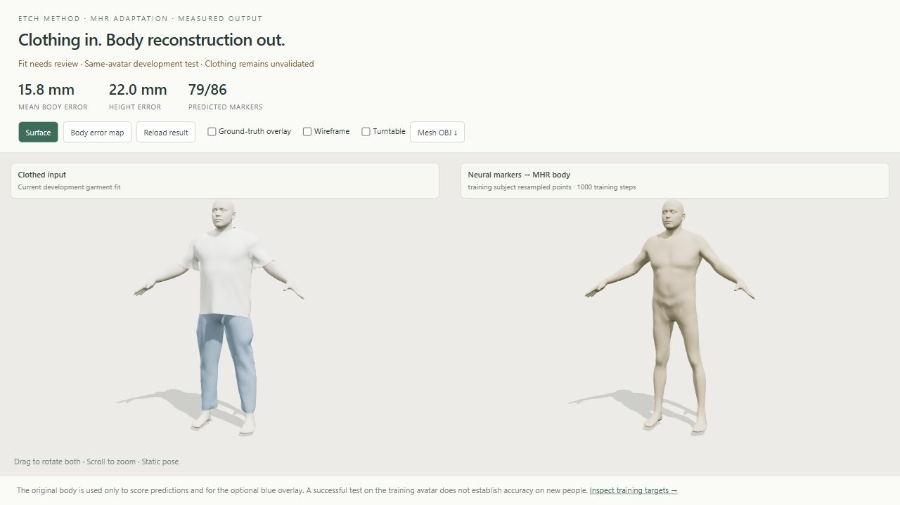
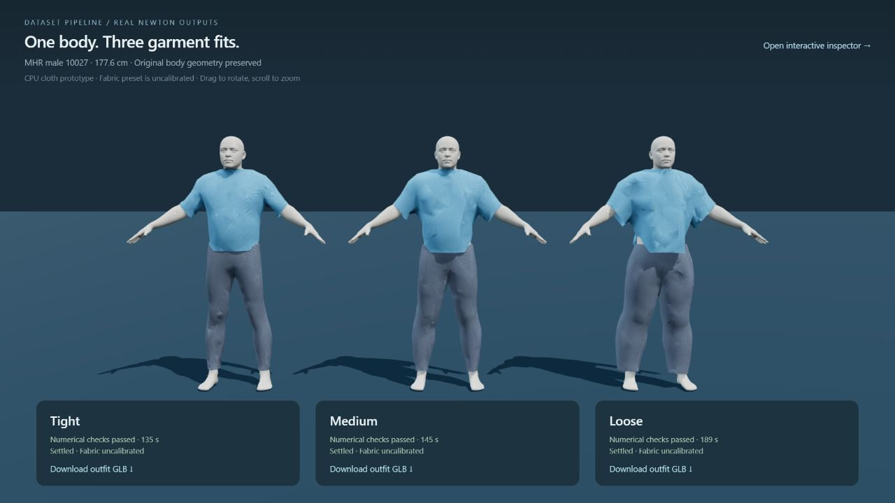

# Dataset-pipeline

**Pipeline Step 1: DONE — automated dataset-to-MHR mesh generation.**

The dataset import, official MHR setup, mesh tests, sample fitting, and resumable
per-record handoffs are complete. See `docs/step-1-done.md` for the checkpoint.

**Pipeline Step 2: recommended direction — EC2 GPU cloth simulation + Three.js viewing.**

**Local male-avatar prototype:** `run_clothing.py` provides Newton VBD cloth
simulation with original flat sewing patterns and a Three.js viewer for the supplied
`inputs/MHR-male-10027` body. The shirt has no pinned collar. The viewer can play
actual saved draping frames and inspect the shirt and trousers up close.
See `docs/local-avatar-clothing.md` for the one-command launch, actual scope,
CPU-only environment, support constraints and validation status. This is a local
prototype; it does not complete the full dataset/female/GPU benchmark scope below.

The supplied video is now the visual target for an original white tee and blue
elastic-cuff jogger preset. Run
`python run_clothing.py --preset reference --contact-every 4`,
or use `RUN-REFERENCE-CLOTHING.cmd`. It generates four separate
fit cases and opens `web/clothing-viewer/reference.html`. See
`docs/reference-clothing-target.txt` for the scope and acceptance criteria.
Reference matching, calibrated fabric and moving-arm cloth are not yet validated.

**ETCH method adaptation:** `run_etch.py` prepares visible cloth/body target pairs,
trains a fresh MHR-native tightness network, votes for 86 body markers and fits
the official MHR model at its neutral pose with a global similarity transform.
It is an independently implemented adaptation, with a different encoder from
the released EPN/SMPL system. No noncommercial ETCH weights are used. See
`docs/etch-integration.txt` for the reviewed paper, commands, differences and
actual validation scope. The current failed clothing sample remains development-only;
normal training refuses it. Articulated recovery and unseen-subject accuracy
are not validated.

The v2 correction restores XYZ spatial information in the scalar heads and the
released loader's default of no rotation augmentation. `run_etch.py evaluate`
scores real neural predictions, marker errors and body errors in millimetres;
`web/clothing-viewer/reconstruction.html` compares the actual fitted mesh with
the input and offers an error map. See `docs/etch-corrections.txt` for the source
comparison, resampling experiment and remaining architecture differences.
The completed 1000-step CPU test produced a mesh with 15.8 mm mean body error
on separately sampled points from the same training avatar. It still fails the
marker-fit gate, and the 90-degree rotation test fails badly. This is not a
validated sizing model. Actual results and failures are recorded in
`reports/etch-corrected-validation.json`.



The earlier body-shell prototype passed numerical checks but failed visual review.
Its archived comparison is shown below; it is not a claim of realistic fabric fit.



The user confirmed future commercial use and approved Python/GPU simulation on
EC2. The source review recommends modern Newton/Warp: compare SolverStyle3D and
SolverVBD on the actual MHR bodies before selecting a solver. See
`docs/cloth-technology-evaluation.md` for the comparison, published tests,
dependency restrictions and acceptance cases. The active implementation prompt is
`docs/ec2-gpu-clothing-handoff.txt`. The full dataset backend and formal solver
comparison are **not yet validated**; no MD/VStitcher-equivalent quality or
speedup is claimed. The local male pilot is recorded separately above.

`python scripts/prepare_cloth_benchmark.py` reproduces a plan of 14 subjects and
60 **not-run** outfit cases per solver in `reports/cloth-benchmark-plan.json`.
It prepares cases only. The older browser-only handoff is superseded.

The earlier VStitcher integration below is preserved as historical work.

The clothing stage selects sex-matched random garments and three graded fit
conditions: **tight, medium, loose**. It exports an unchanged OBJ avatar and
prepares native VStitcher jobs. The generated male sample has been imported into
the signed-in VStitcher desktop on EC2. CLI/API execution, avatar placement anchors,
and a real male/female garment catalog still need validation for actual simulations. See
`docs/step-2-vstitcher.md` for setup, fit definitions and validation scope.

## Automated run

After the one-time environment and MHR asset setup below, run:

```sh
python -m pipeline run
```

The program reads the dataset in order. For each record it generates a mesh,
checks the fit, reproduces the exported mesh from its saved MHR inputs, and writes
the verified result as a handoff for the next stage. It finishes that record before
starting the next. The model is loaded once for the run.

Run the same command again to resume. Verified completed meshes are checked and
reused. Missing or modified artifacts are regenerated, and failed records are
retried. An interrupted run keeps its completed record checkpoints.

For a small trial:

```sh
python -m pipeline run --limit 2
```

Outputs are under `runs/pipeline/subjects/<subject_id>/`. Each record includes the
mesh, exact MHR inputs, source measurements, fit report, `checkpoint.json`, and
`handoff.json`. `progress.json`, `events.jsonl`, and `run-report.json` track the run.
Rejected or failed meshes are recorded and withheld from the next stage; processing
continues with the next record and the command exits with code 2 when any record fails.

For the **historical VStitcher preparation** (not the proposed GPU backend), use:

```sh
python -m pipeline run --clothing-config configs/clothing.example.json --clothing-mode prepare
```

Without a clothing config, validated meshes wait in their handoff files with
status `ready_for_next_stage`. Other local processing functions can be connected
so every accepted mesh is passed to them immediately:

```sh
python -m pipeline run --next-stage my_next_stage:process
```

The consumer receives a handoff dictionary with the subject ID, artifact paths,
checksums, units, and a stable idempotency key. See `docs/pipeline-contract.md`.

## Dataset import

The original ANSUR II measurement dataset has been imported from
`Twinnie-Inc/TWINNIE`, branch `Mahmoud-Dataset-5.8`, commit
`2f901e81447103dba946b301d844f0fd6476a710`.

Source folder: `Scripts/Dataset/fixtures/ansur2`.
Local folder: `data/raw/ansur2`.

- `ansur2_male.csv`: 4,082 records, 108 columns.
- `ansur2_female.csv`: 1,986 records, 108 columns.
- Total: 6,068 records.

Both CSV files and the original `SOURCE.md` are preserved byte-for-byte.
`provenance.json` records the exact source and verified SHA-256 checksums.
The original `SOURCE.md` checksums use CRLF line endings; the imported Git blobs
use LF. Content equivalence was verified, and both hashes are recorded.

Verify this import with Python 3:

```sh
python scripts/verify_dataset.py
```

The CSVs use Latin-1 encoding. Linear measurements are in millimetres;
`weightkg` is in tenths of a kilogram. The original source documentation
explains the dataset provenance and Army population scope.

## Official MHR source

The full official Meta MHR source is in `third_party/MHR`, pinned at commit
`d96fafa33bbf018647c70c3525e91f53e79d2a14`. Its license and original files are
preserved. See `THIRD_PARTY.md`.

## MHR mesh generation test

From this repository root, create a Python 3.11+ environment and install dependencies:

```sh
python -m venv .venv
# Windows: .venv\Scripts\activate
# Linux/macOS: source .venv/bin/activate
python -m pip install -r requirements.txt
python scripts/download_mhr_assets.py
python -m pipeline smoke-mhr
```

The downloader verifies the official `v1.0.1` archive checksum, then extracts its
TorchScript model. This supported MHR backend runs on CPU and embeds the mesh
topology, so it needs no separate PyMomentum installation.

The smoke test verifies finite vertices and skeleton, deterministic inference,
response to an identity parameter, valid triangle indices, and PLY export/reload.
`examples/smoke/neutral.ply` and `examples/smoke/smoke-report.json` contain the
verified result: 18,439 vertices and 36,874 triangles. Mesh units are centimetres,
with Y as the vertical axis.

Downloaded model assets and ordinary runs stay outside Git. Each completed step
is committed separately.

## Dataset record to MHR mesh

```sh
python -m pipeline normalize
python -m pipeline fit --subject-id ansur2_male_10027 --subject-id ansur2_female_10037
python -m pipeline verify --directory runs/subjects
```

The importer converts all 6,068 records to centimetres and kilograms. The fitter
optimizes the first 20 MHR body identity coefficients using chest, waist and hip
section perimeters at the corresponding ANSUR height levels. It applies a uniform
scale to match standing height. Pose, head, hands and facial expression retain their
neutral defaults. All original anthropometry is retained in each source record.

The generated mesh is produced by a final call to the official MHR model. Each
subject folder contains `body.ply`, `mhr-inputs.npz`, `source-record.json`, and
`fit-report.json`. The input file records the exact coefficients, pose, expression
and scale/grounding transform needed to reproduce the exported mesh. The native
skeleton is also included and is explicitly labelled as unscaled.

For a full batch, use `python -m pipeline fit --all`. This is an explicit action;
the checked-in examples cover two records, not a completed 6,068-mesh batch.
The command exits with code 2 if any completed fit fails its 2 cm perimeter
tolerance or solver/closed-mesh checks. Failed fits retain a `rejected_fit` report.

These are **estimated bodies** fitted to height and three section-perimeter proxies.
The section definitions still need anatomical validation; matching these values
does not establish that all body dimensions match the measured person. Remaining
measurements and mass are recorded as unfitted. This stage provides an executable
measurement-to-mesh baseline for the requested initial MHR test.

The tested male and female meshes and reports are in `examples/fitted`. Preview a
generated mesh by importing `body.ply` in Blender or MeshLab, or build an interactive
preview with embedded geometry:

```sh
python scripts/preview_mesh.py --mesh runs/subjects/ansur2_male_10027/body.ply --output mesh-preview.html
```

The preview uses Three.js from a public CDN. Its geometry is embedded in the file.

Run the pipeline's tests with:

```sh
python -m pip install -r requirements-dev.txt
python -m pytest
```

Tests cover source counts and units, analytic section perimeters and derivatives,
separation of disjoint limb sections, missing-section rejection, and exact stature
scaling. Official model inference and exported-mesh reproduction are checked by
the `smoke-mhr` and `verify` commands. The vendored Python/PyMomentum test suite
requires its own optional upstream environment.
